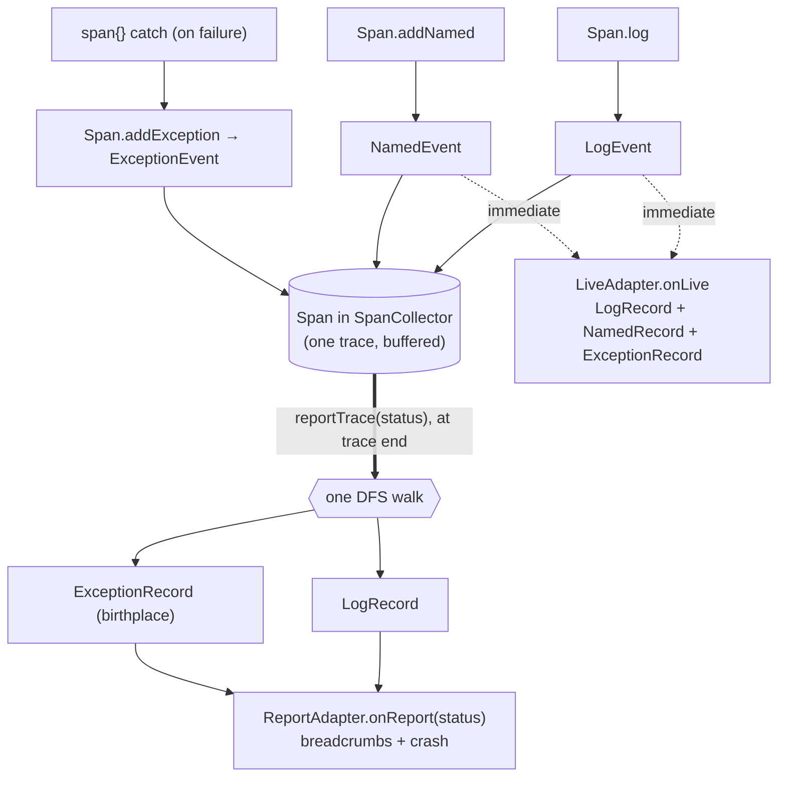
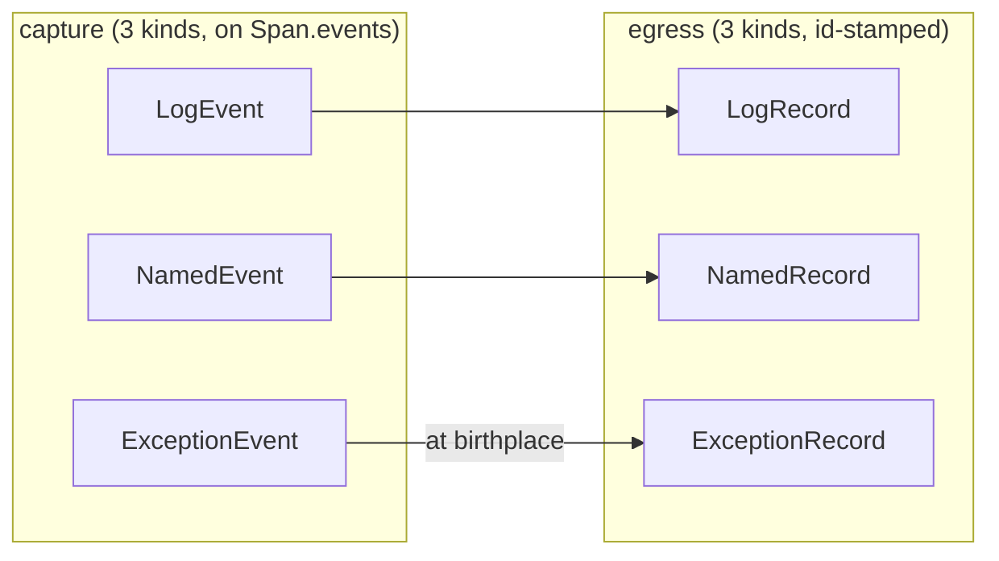
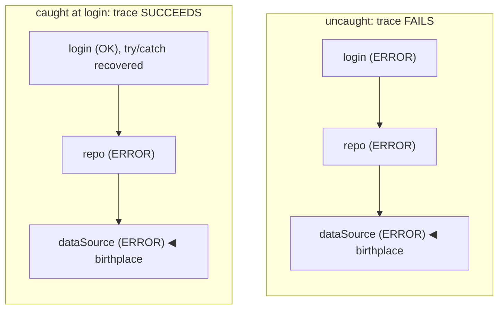

# kotrace architecture

How the pieces fit and **why** they are shaped the way they are. [README.md](README.md) is the
what-and-how-to-use; this is the reference for the design decisions behind it. Read it before changing the
data model, the fan-out, or the boundary rules.

---

## 1. Scope, and what kotrace deliberately is not

kotrace is a **tiny, in-process, coroutine-native span tracer** for Kotlin/JVM. It builds a per-flow tree
of spans over `CoroutineContext`, marks the failing path, and fans the finished tree out to consumer
**adapters**, while emitting a **W3C `traceparent`** header so a client trace stitches to a backend one
with **no OpenTelemetry SDK** on either side.

It is scoped **narrowly on purpose**. The narrowness is what lets it stay small and make choices a
general-purpose observability SDK cannot:

| kotrace does | kotrace does **not** |
|---|---|
| one process, one call tree per flow | distributed tracing across services |
| buffer the tree, decide reporting at the end (**tail**) | head sampling / per-span streaming |
| span events bound to an operation | a standalone log store (a span-less emit goes live only) |
| keep the live `Throwable` for a crash reporter | serialize everything for a wire exporter |
| a `traceparent` on the wire as the upgrade seam | its own backend / collector protocol |

The **wire format is the contract**: an OpenTelemetry upgrade later is additive (§9).

### At a glance



Capture is **normalized** (events on the span, id stored once); egress is **denormalized** (flat,
id-stamped records). Live fans out per-event as it happens; report fans the whole tree out once at the end.

Which events reach the **report** is one declared predicate, `SpanEvent.reportable()` (`report/Report.kt`),
exhaustive over the sealed `SpanEvent`: `LogEvent` and `ExceptionEvent` yes, `NamedEvent` no (live-only). It
gates *whether*, not *how*: `reportTrace` still collects a log per span and the exception at the birthplace. It
is not an implicit `filterIsInstance`: a future event kind fails to compile until it classifies itself
there, so it can never be silently dropped from a failure report.

### Vocabulary

The canonical words. kotrace **owns** these. A consumer (for example, the Camailux `:core:common` facade)
references them and adds its own binding terms on top; it does not redefine them. The four verbs never
interchange.

| Term | Precisely |
|---|---|
| **tracing** | the concern / this library, never a runtime object. |
| **trace** | **one call tree** = one `trace_id`, per flow. The verb that opens a **span** within it is `span(name){}`, named for the node it opens, not the tree (ADR-003). |
| **scope** | a **live-only correlation umbrella above a trace** (`scope ⊇ trace ⊇ span`, ADR-010): a nullable `scope_id`, set by `withScope(scopeId){}`. **Not a span**: it opens no reportable tree and has no duration, outcome, `status`, or report path; it is a plain correlation key, never a filter dimension. Groups many traces **and** their orphan emits under one session/journey key. Outside any `withScope`, a record takes the process-wide **fallback scope** installed with `Kotrace.install(fallbackScopeId = …)`, if any (ADR-038); an ambient scope always wins. |
| **span** | **one node** (`Span`): a name, a status, `traits`, `attributes`, `events` (the birthplace `ExceptionEvent`, if any, lives among them; there is no `error` field), a parent. Entity, not value (§2). |
| **link** | a **cross-trace causal edge** (`TraceLink` on `Span.links`): a reference to another *trace* by `trace_id` only (no `span_id`; ADR-009), the OpenTelemetry *span link* shape. Distinct from `parentId` (the **in-tree** edge). Birth-set like `attributes`; surfaces on the wire as a `links` array on every record off the span. Never interchange with **parent**. |
| **operation** | the owning **`Span.name`** at egress: its label as the flat **join key** on every `TraceRecord` and `toJson` column. `name` = the in-memory field; `operation` = that value as the wire/backend-join key (OpenTelemetry-aligned). A **wire contract** (§2), and distinct from `NamedRecord.name` (the *event*'s name). |
| **record** | a flat **egress line** (`TraceRecord`), lifted off a span at fan-out. Three kinds ↓. |
| **log** | a **breadcrumb** event (`Span.log` → `LogEvent` → `LogRecord`): a line bound to a span. |
| **event** (named) | a **named / analytics** occurrence (`Span.addNamed` → `NamedEvent` → `NamedRecord`, OpenTelemetry `addEvent` shape). |
| **exception** | the **birthplace crash**: an `ExceptionEvent` on `Span.events` (read via the `Span.exception` extension, §8), surfaced at egress as `ExceptionRecord`. It is subject only to `TracePolicy.acceptsEvent` (which defaults to keeping it), so a breadcrumb filter never drops the crash unless a policy explicitly covers exceptions; it does **not** bypass every gate. |
| **span-less emit** | `emitLog` / `emitNamed` / `emitException` (ADR-010): the **orphan** counterparts of the span-scoped `log` / `addNamed` / `addException`, for an occurrence outside any span (an app-lifecycle or push callback, a non-coroutine entry). Fanned **live-only** through the resolved configuration (context override, else the process-wide `Kotrace` configuration ↓), gated by policy; a record with null identity, carrying the active `withScope`'s `scope_id`, else the installed fallback's (ADR-038). `emitException(cause, attributes)` (and `addException(cause, attributes)`) populate record-level `ExceptionRecord.spanAttributes` while the event stays object-only (ADR-005). |
| **report** | the **tail** fan-out at trace end (`ReportAdapter.onReport(status)`): buffered tree, breadcrumbs + crash, gated by status. |
| **live** | the **per-event** fan-out as it happens (`LiveAdapter.onLive`): immediate, ungated by trace status. |
| **status** | `SpanStatus` = one node's outcome; `TraceStatus` = the whole trace's verdict (`OK`/`ERROR`/`CANCELLED`). Separate on purpose (§2). |
| **adapter** | a consumer sink (`TraceAdapter`): `ReportAdapter` (tail) or `LiveAdapter` (per-event). |

---

## 2. The data model

Two levels, deliberately distinct: **capture** (rich, span-local, cheap to buffer) and **egress** (flat,
identity-stamped, adapter-ready). The tracer normalizes at capture and denormalizes only at the boundary.

### `Span`: the node (an entity, not a value)

A `Span` is one unit of work; a tree of them linked by `parentId` is the call path. It is a **plain
`class`, not a `data class`**:

- It has **identity** (`spanId`, a 64-bit random hex) and **mutates over its life**: `status` and `endNanos`
  change after it opens (a safely-published atomic pair, ADR-006), and it gains events and `attributes`. Value
  semantics are wrong for it: a generated `hashCode` over that mutable state
  would shift while the span sits in a collection; `copy()` would mint a second span sharing one `spanId`.
  Two spans are the same span iff they are the same instance.
- There is **no exception field**: a throwable is an `ExceptionEvent` on the span's timeline, read via the
  `Span.exception` extension (see §8).
- Its timeline is **copy-on-write and bounded** (`EventTimeline`, ADR-029/033): appends from parallel children
  and off-coroutine bridges are serialized, a read or a report snapshot takes the current array without a lock,
  and past `maxEvents` an append discards the oldest named event, else the oldest log, else the oldest
  exception, in the same copy. `droppedEvents` counts the discards.

`spanId`/`traceId` uniqueness is **probabilistic, not enforced** (random, no registry): within one trace
(a handful of spans) a 64-bit collision is ~0, matching the W3C guarantee.

A span carries **two** string→string channels, split by role (ADR-001, names from ADR-032):

- **`traits`**: **fixed filter dimensions**, an immutable `Map` set at birth (`layer=http`). The *only*
  per-span input a `TracePolicy.acceptsSpan` gate reads. Immutable, so a gate decides identically at live
  emit and report, with no dependence on when it runs. Traits never reach a record.
- **`attributes`**: the payload a sink sees, a mutable channel seeded when the span opens
  (`span(…, attributes = …)`) and written later via `putAttribute`, often with a late value (`http.status`, known
  only once the response returns). It rides onto every `TraceRecord` as
  `spanAttributes` but is **never** a filter key.

The split is a correctness invariant, not tidiness: a value known only late (a result) cannot be a filter
input, because at live emit time its presence varies with event order, and a policy filtering on it would race. So
late values are attributes (payload), fixed birth values are traits (filter). See §4, ADR-001 and ADR-032.

### `SpanEvent`: a capture-time occurrence (sealed)

```
sealed interface SpanEvent { atNanos }
  ├─ LogEvent(attributes, message, sensitive)   // a log line: Span.log
  ├─ NamedEvent(name, attributes)               // an OTel event.name occurrence: Span.addNamed
  └─ ExceptionEvent(throwable, lineageKey)      // a recorded throwable: Span.addException, a span's catch (§8)
```

An **event is the umbrella**; a log line is one *kind* of it, a named/analytics occurrence another, a recorded
throwable the third. The
name is `SpanEvent`, not `SpanLog`, precisely to leave room for the non-log kind. Events are the
**normalized** form: the span's identity lives once on the `Span`, so buffering N events costs no repeated
id. Most traces succeed and their events are discarded, so buffering the lean form, not id-stamped records,
is the tail-efficiency win.

`sensitive` is a **capture-site classification** (this message carries user data, such as a captured body), **not**
a routing decision. Where it goes is a policy decision (§4); the flag only says *what it is*.

### `TraceRecord`: an egress line (sealed)

```
sealed interface TraceRecord { traceId?, spanId?, parentId?, operation?, atNanos, scopeId?, spanAttributes, links }
  ├─ LogRecord(attributes, message, sensitive)  // from a LogEvent
  ├─ NamedRecord(name, attributes)              // from a NamedEvent
  └─ ExceptionRecord(throwable, origin)         // from an ExceptionEvent; origin BIRTHPLACE / PROPAGATED (ADR-019)
```

The **denormalized** form: flat, with the identity/join fields stamped on (a raw `SpanEvent` carries
none). This is the **contract an adapter sees**: the rich `Span` never crosses to a consumer, so a
consumer never depends on kotrace's internal node shape.

**`scope_id`, above `trace_id`** (ADR-010). A nullable correlation key, one level up (`scope ⊇ trace ⊇
span`): a span opened inside a `withScope` stamps it alongside `trace_id`; a span-less emit inside one
carries it alone. Outside any `withScope`, both take the process-wide fallback installed with
`Kotrace.install(fallbackScopeId = …)` (ADR-038): one internal resolver gives every site (a span opening, a
span-less emit, `startSpan`, `TraceHandoff`) the ambient id, else the fallback's value, else null. The provider is
read at each resolution and only when no ambient scope exists; a throw from it yields null and reaches the
`FaultHook` (`scope.fallback`), so the record is still delivered. `toJson` emits `"scope_id"` **only when
non-null**, so a record with no scope has no such key (parallel to ADR-004 nesting). It is **never** read by a
`TracePolicy`, the report path, or any status/duration/outcome logic: a plain key, kept a distinct field
so that distinction is structural, not conventional.

**Nullable identity** (ADR-010). `traceId` / `spanId` / `operation` are nullable because a **span-less
emit** (`emitLog` / `emitNamed` / `emitException`) has no span and thus no trace, so its record carries null
identity and (if a scope or the fallback applies) a `scope_id`. A record lifted off a real `Span` always has them set.

**`operation` versus `name` : the egress rename** (defined in §1 Vocabulary). `operation` is the owning
`Span.name`, carried on every record as the flat join key; it is a `toJson` column, so it is a **wire
contract** a backend joins on. It collides deliberately with `NamedRecord.name`, which is the *event*'s
name (`NamedEvent.name`): on a `NamedRecord`, `operation` = the span, `name` = the event. Renaming
`operation`→`name` would both alias the event name and break the join wire, so both stay.

Capture and egress are both **three** kinds, one-to-one. The sealed `SpanEvent` has `LogEvent`,
`NamedEvent`, and `ExceptionEvent`: the exception is an **event on the span**, not a `Span.error` field
(its single source of truth is `Span.events`, read via the `Span.exception` extension). `ExceptionRecord` is
lifted from the birthplace `ExceptionEvent`, the deepest throwable-bearing span on a branch (ADR-005).
Mapping:



---

## 3. Propagation and boundaries: four context elements

kotrace hangs four things on the `CoroutineContext`, each a `ThreadContextElement` with a `ThreadLocal`
mirror. The mirror is what lets **non-suspend code on a coroutine's thread** (an OkHttp factory, a Room
callback) read them without a `coroutineContext` handle.

| Element | Carries | Read via | Decides |
|---|---|---|---|
| `SpanContext` | the active span | `currentThreadSpan()` (suspend: `currentSpan()`) | who is a new span's **parent** |
| `SpanCollector` | every span in one trace | `currentThreadCollector()` | which tree is **collected** |
| `TraceConfig` | the consumer's adapters + policies | `currentThreadConfig()` (suspend: `currentConfig()`) | how the trace **fans out** |
| `ScopeContext` | the ambient `scope_id` (ADR-010) | `currentThreadScopeId()` (suspend: `currentScopeId()`), ambient only | the correlation umbrella above `trace_id`; without one, a record takes the installed fallback (ADR-038) |

These are **four separate boundaries**, decoupled on purpose: a span can have a `traceId` (identity) but no
collector (untraced-but-identified); the configuration is orthogonal to both. Why a `ThreadContextElement` and not
a bare `ThreadLocal`: a coroutine resumes on different threads, so the mirror must be re-established on every
resume and restored on the way out; that is exactly the `updateThreadContext`/`restoreThreadContext`
contract. `AbstractCoroutineContextElement` supplies only the `key` plumbing; it could be handwritten.

### `SpanCollector` is per-trace and ephemeral

One collector = one trace, seeded at the root and dead when the root returns (fan-out, then GC). The seeding
is normally **implicit**: a top-level `span { }` opened with no span and no collector in context **auto-roots**
(ADR-013): it installs the collector (`withContext(collector)`), opens the root, and calls `reportTrace` at
the outcome; a consumer may still seed one by hand (`withContext(collector)` + its own `reportTrace`) for
bespoke control. There is **no global registry** accumulating traces, and that is what keeps memory flat and
what makes kotrace's tail decision safe (§4): it buffers exactly one flow at a time.

A hand-seeded collector can still end up holding **more than one tree**: two top-level spans under it, or a
collector seeded inside a traced flow, whose spans are children of a span it does not hold. `reportTrace`
walks every root (a parentless span, or one whose parent is not in the collector) into the one report, each
record keeping its own `trace_id`/`parent_id`, and `renderTree` renders each root (ADR-026). Nothing is dropped
because it is not under the first root.

**The one process-global** (ADR-010). Per-*flow* state (the collector, the current span, the scope) is
context-scoped and pure. **Configuration is not per-flow**: which sinks and policies a consumer runs is static and
process-wide, so it lives in `Kotrace`, the install-once fan-out configuration. Every fan-out path reads the
`TraceConfig` on its context first and falls back to the installed one, so the global is the default and a
per-flow `TraceConfig` on the context (`withContext(collector + TraceConfig(...))`) is an **override** for that
flow.
This is what lets a **span-less emit** and a non-suspend root fan out with no coroutine to carry adapters.
`Kotrace.install(...)` publishes the configuration once at startup through an `AtomicReference` (safe publication);
it is read-only after, and a second installation is a hard error (fail-closed, no silent replace). The library's
process state is that configuration, the `FaultHook` (installed once the same way, apart from it, ADR-037) and
the opt-in strict switch (ADR-011); all are optional: with nothing installed and no override, every path is a
safe no-op. (Report needs a `SpanCollector`: a top-level suspend `span` auto-roots
one (ADR-013); a non-suspend flow or a flow that only performs span-less emission has none, so it is live-only by
construction.)

**Setup guidance.** Under dependency injection (Hilt/Koin), resolve the adapters from the graph and `install` once at app
start; the `install { … }` provider overload registers a supplier resolved lazily on first fan-out, for when
the graph is not ready at class-load. A flow needing *different* sinks overlays a per-flow `TraceConfig` on
its context (an override), so the global is not a straitjacket. Reserve the global for framework-owned,
non-suspend entrypoints (app lifecycle, a push callback) where no context can be threaded in; everything
coroutine-rooted can use a context `TraceConfig` instead, which is also what keeps tests hermetic (they set
their own configuration per `withContext` and never touch the global).

### The failing path, and why `status` propagates

`span { }` is instrumentation: it observes and **rethrows**, never swallows. On the way up, *each* enclosing
`span`'s catch marks its span `ERROR` and rethrows. So the **whole ancestor chain** the exception passed
through uncaught is marked, and it stops exactly where a `try/catch` handled it. This is runtime
control-flow information: a deep-search over the finished tree **cannot** distinguish "error handled and
recovered" (trace OK) from "error escaped" (trace failed), because both leave the same error at the
birthplace. Propagated `status` records where the exception actually stopped; that is why it must be set as
the exception travels, not derived afterward.



The throwable is born at `dataSource` and marks each span its rethrow passes through, until a `try/catch`
stops it. Same error at the birthplace in both trees; only propagated `status` (login OK versus ERROR) tells the
two apart. A read-time search over the finished tree cannot.

The same catch also records the climbing throwable on each ancestor, as an `ExceptionEvent` on that span's
timeline (§8). Every copy of one failure carries the same **lineage key** (ADR-015), even when coroutine
stack-trace recovery hands each boundary a copy, so the report can tell the copies from the origin (§ birthplace).

### Birthplace

The **birthplace** of a failure is the deepest span carrying its lineage: an `ExceptionEvent` belongs at a span
iff no descendant carries the same lineage key (`TraceTreeIndex.birthplaceExceptionsOf`, ADR-015). The report
emits every copy, stamped `BIRTHPLACE` or `PROPAGATED` (ADR-019), and a default adapter drops the propagated ones
(`TracePolicy.acceptsPropagatedException`), so a crash sink sees each failure once, not once per ancestor.
Keying on the throwable's lineage (not merely "no child errored") is what stops a throwable-less `ERROR` leaf (a
bridge span ended `end(ERROR, null)`, for example, an OkHttp 500 that returned) from shadowing an ancestor's real crash
out of the report, and keeps two unrelated failures on one branch apart. `report` is the sole birthplace
authority; there is no separate public helper. A surviving record is gated **only** by
`TracePolicy.acceptsEvent` (default: kept), so a breadcrumb filter never swallows the crash cause unless a
policy explicitly covers exceptions.

---

## 4. The one fan-out path

There is a **single** fan-out mechanism; the consumer supplies all policy through **adapters**. Many
adapters = many independent routes off one trace, with no core change.

```
sealed interface TraceAdapter { policy: TracePolicy }
  ├─ LiveAdapter   { onLive(record) }                       // per-event, as it happens
  └─ ReportAdapter { onReport(status, records: Sequence) }  // whole tree, at the end

interface TracePolicy {
  acceptsSpan(span): Boolean            // per-span breadcrumb filter: reads span.traits ONLY (fixed,
                                        //   birth-set); never span.attributes (late), the race-free invariant, ADR-001
  acceptsEvent(event): Boolean          // per-event filter over SpanEvent (e.g. a "level" attribute threshold)
  acceptsSensitive: Boolean             // receive sensitive records? default false (fail-closed)
  acceptsPropagatedException: Boolean   // receive PROPAGATED climb copies, or birthplaces only? default false
                                        //   report-only, ADR-019
}
```

- **Role, not flag.** An adapter *is* a `LiveAdapter` and/or a `ReportAdapter`; membership (`is LiveAdapter`)
  replaces any `wantsLive` flag, so the two can never fall out of sync.
- **Self-gate, lazily.** `onReport` receives the `status`, so a failure-only adapter writes
  `if (status == TraceStatus.OK) return`; `records` is a lazy `Sequence`, so a skipped outcome forces no walk or
  allocation. There is no separate `reports(status)` predicate: it would just re-hand the status the
  callback already has.
- **One walk, N views.** `SpanCollector.reportTrace(status)` walks the tree once into `(span, event, origin)`
  entries; each adapter gets a lazy view filtered by *its* policy. A `LogRecord` passes `acceptsSpan(span)` ∧
  `acceptsEvent(event)` ∧ (`!sensitive` ∨ `acceptsSensitive`). `NamedRecord`s are **not** in the report path:
  analytics is a live concern (below).
- **Birthplace versus propagated is a per-adapter view, not a global truncation** (ADR-019). The walk keeps a
  climbing exception's ancestor copies and stamps each `ExceptionRecord` `BIRTHPLACE` (deepest span carrying the
  lineage, ADR-015) or `PROPAGATED` (an ancestor copy). The view drops `PROPAGATED` unless the adapter opts in
  via `acceptsPropagatedException`, applied **before** `acceptsEvent`, so a default (crash) adapter is never
  invoked on a dropped copy and sees birthplaces only. An opt-in (log/trace-viz) adapter receives the full
  marked climb off the *same* walk. `toJson` writes `"exception_origin":"propagated"` only on a `PROPAGATED`
  record, so a birthplace record carries no origin key. A live `ExceptionRecord` is unclassified
  (`origin = null`): the tree is incomplete when it is emitted.

### Live versus report: two timings, one mechanism

| | Emitted | Kinds | Trigger |
|---|---|---|---|
| **Live** (`onLive`) | per event, immediately | `LogRecord`, `NamedRecord`, `ExceptionRecord` | any registered `LiveAdapter` |
| **Report** (`onReport`) | once, at trace end | `LogRecord`, `ExceptionRecord` | `reportTrace(status)` |

A **named/analytics** event fires **live** (on success too), never tail-buffered for failure; that is the
right lifecycle for product data. A **log breadcrumb** rides both: live if a live adapter is watching, and
buffered to the end report. The **exception** rides both too: live as it is thrown (a watch sees it climb
the tree, deepest first, ungated by trace status), and at report, where the default view is deduped to the birthplace,
gated on failure, an `acceptsPropagatedException` adapter seeing the whole marked climb (ADR-019). Live is
awareness; report is the crash verdict (§8). Building the live record is skipped
entirely when no live adapter is registered, so a production report-only trace pays nothing per event.

### Tail, not head

Because the whole tree is buffered in-process, kotrace decides reporting **after** seeing the outcome, a
tail decision, made for free by the buffer it already keeps. It never has to sample blind at the source the
way a streaming SDK does. The cost is holding one flow's spans in RAM until it ends; the ephemeral,
one-trace `SpanCollector` (§3) keeps that bounded.

### Configuration is immutable, var-free

`TraceConfig(adapters)` is an immutable object holding the consumer's sinks. `liveAdapters`/`reportAdapters`
are partitioned once at construction, so the hot path reads a precomputed list. **Which configuration a path uses**
is resolved once, at the fan-out site (ADR-010): a per-flow context override if one is in scope, else the
process-wide `Kotrace` configuration (§3). Configuration is
static, process-wide data, so its home is the install-once global; only per-flow state (the collector, the
current span, the scope) is genuinely contextual. That one resolution feeds **every** path identically
(span and span-less, live and report, suspend and non-suspend), so they differ only in the coroutine
mechanism that locates the flow, never in which adapters see a record. There is **no capture gate** (ADR-002):
the event verbs store unconditionally and filtering happens once, per adapter, at fan-out (`policy.accepts`
in `emit` live, `viewOf` at report). Registering a DEBUG-wanting adapter is still the only step needed to
surface DEBUG: it decides delivery, not storage. A rejected event never resolves its lazy message: `emit`
filters *before* building the record, and `viewOf` maps only accepted entries, so a message builds only
when some adapter accepts it. The `ExceptionEvent`, like every event, is appended unconditionally, so a
layer-filtered span still reports its birthplace crash, and a live adapter sees the crash the moment it is
thrown, not only at fan-out.

---

## 5. Capture

**Opening spans.** `span(name, traits) { }` opens a child (suspend, closes on return); `startSpan(name,
traits)` does the same for non-suspend code off the coroutine frame (closed with `Span.end()`). Both
mint the span through one private `createSpan(parent, …)`, the parent resolved from the coroutine context
(`span`), or for `startSpan` passed in, defaulting to the `currentThreadSpan()` mirror (a `TraceHandoff`'s
captured parent off the coroutine's thread, ADR-023). `startSpan`/`end` are the non-suspend bridge,
gated behind the `@NonSuspendTracingBridge` opt-in (`ERROR`) because, unlike `span`, they do not install
the span into the coroutine context, so a nested suspend `span` would misparent; the OkHttp bridge opts in
at its one legitimate site (ADR-003). The `traits` a span is opened with are its fixed filter
dimensions (§2, ADR-001); kotrace ships the mechanism and names no layers; a consumer folds its own layer
vocabulary in at the call site (or, like Camailux, behind its own thin wrappers).

**Event verbs are all extensions on `Span`** (`Span.log`, `Span.addNamed`, `Span.addException`): one
uniform shape; there is no ambient no-receiver form. The caller resolves the span with a getter and calls
the verb on it. Every verb stores its event unconditionally: there is no capture gate (§4, ADR-002); the
log message lambda is still not built for an event no adapter accepts, because `emit`/`viewOf` resolve it
only at fan-out, so a filtered log costs nothing to build.

| Getter | For | Reads |
|---|---|---|
| `suspend currentSpan()` | a suspend caller | `coroutineContext[SpanContext]` (source of truth) |
| `currentThreadSpan()` | non-suspend code on the coroutine's thread (OkHttp/Room bridge) | the ThreadLocal mirror |
| a span **held directly** | a bridge that carries the span across a thread boundary | nothing (already in hand) |

So a suspend caller writes `currentSpan()?.log(attributes) { }`; a non-suspend bridge writes
`currentThreadSpan()?.log { }` or `heldSpan.log { }`. `addException` is the same shape (see §8).

kotrace stays generic: `addNamed` names no "analytics": the meaning (consent, destination) lives in the
consumer's `LiveAdapter`. To surface one safe field from a sensitive body, log it as a **separate
non-sensitive** `LogEvent`/`NamedEvent` at the layer that parsed it, never by un-marking the body.

---

## 6. The wire: `traceparent`

`Span.toTraceparent()` renders the W3C `00-<trace_id>-<span_id>-<flags>` header. This is the cross-process
boundary: a client span emits it, a backend continues the **same** `traceId`, and the two stitch with no
shared SDK. `TraceRecord.toJson()` renders a one-line snake_case record for a JSON log pipeline (ELK/Loki)
to ingest `trace_id`/`span_id` as queryable fields, with the event's `attributes` and the span's
`span_attributes` nested under their own objects (ADR-004/032) and any cross-trace **`links`** as a nested
`[{"trace_id":…,"attributes":{…}}]` array (ADR-009, omitted when empty): the machine, PII-safe counterpart to
the unredacted, `@UnredactedTraceRead`-gated `renderTree` (ADR-008).

---

## 7. Integrations (separate modules)

The core is pure Kotlin (`kotlinx-coroutines` only). Client/DB glue ships as opt-in modules so a Ktor or
pure-JVM consumer drags neither:

- **`kotrace-okhttp`**: `TracingCallFactory` captures the flow's trace context at `newCall` **on the coroutine
  thread** (where `currentThreadSpan()`/`currentThreadCollector()`/`currentThreadConfig()` still resolve) as a
  `TraceHandoff` and tags it on the request; `TracingInterceptor` reads the tag **on OkHttp's thread**, opens the
  HTTP span **per execution** from it (a clone or retry gets its own span), writes `traceparent`, and reflects
  status/body back while emitting under the flow's captured configuration override (ADR-023). The split exists because
  the interceptor cannot see the coroutine context; the tag is the bridge, and it carries the whole context, not
  only the parent span. Instrumentation never alters the call's response or exception; a fault it contains reaches
  the `FaultHook` as `FaultPhase.HTTP`, and only an armed strict check fails the call (ADR-035). Captured bodies are
  logged as **`sensitive`** events, bounded to `bodyLimit` bytes; a response body is copied as the caller reads
  it (tee-on-read, never read ahead), and streaming and one-shot bodies are omitted (ADR-024).
- **`kotrace-room`**: logs each query's SQL template (never the bound arguments) onto the active span, resolved
  via the `currentThreadSpan()` ThreadLocal (Room runs the suspend query under the caller's coroutine). Room
  keeps one query callback, so an app's own callback is passed as `delegate` and still runs (ADR-028); a fault in
  logging reaches the `FaultHook` as `FaultPhase.DATABASE` and never fails the query (ADR-035).
- **Writing an integration** (Ktor, a database driver): every telemetry step goes through `runIsolated`
  (`@KotraceIntegrationApi`, ADR-035), the rule the core itself follows: a fault is told to the hook with the
  integration's `FaultPhase` and a `faultMessage`, and the traced call's own result or exception is never
  replaced.

---

## 8. The exception as a timeline `ExceptionEvent`

The exception is a span **timeline event** (`ExceptionEvent` on `Span.events`, `TraceException.kt`), not a
`Span.error` field, recorded by `span`'s catch and reconciled at read; dedup comes from the tree's topology at
read time, not from overwriting a field:

1. **Always recorded, and live as it is thrown.** `addException` appends unconditionally: like every event
   verb, it has no capture gate (ADR-002), so a level or layer filter never drops a crash. It also emits
   to live adapters, so a debug watch sees the throwable the moment it unwinds: awareness, distinct from the
   crash verdict.
2. **Paired with `status`.** `status` *is* a field (it propagates, §3); the catch sets it alongside appending
   the `ExceptionEvent`, so the two describe the same span outcome together.
3. **One per failure at report, deduped by lineage.** The same throwable is re-recorded up the whole failing
   path; at the report every copy is stamped, `BIRTHPLACE` at the deepest span carrying its lineage key and
   `PROPAGATED` above it (ADR-015/019), and a default adapter keeps only the birthplace. Live does **not**
   dedup: it shows the full climb (deepest first), the propagation trail as it happens.

Consequence: a **handled** exception (caught at the repository, returned as a value) both surfaces **live**
as it climbs (a WARN-level awareness line in a debug watch) and rides the trace-end report as an
`ExceptionRecord`, deduped to its birthplace and gated on trace status. Live is awareness; report is the
verdict. A non-throwable structured error stays a `Span.log` breadcrumb (§ carrier exception).

---

## 9. Versus OpenTelemetry

kotrace is roughly a **subset of OpenTelemetry gauged for one purpose**, plus one thing OpenTelemetry lacks (a `sensitive`
PII gate in the model). Same words, different scope.

| Concept | OpenTelemetry | kotrace |
|---|---|---|
| Span identity | separate `SpanContext` (traceId+spanId+flags+tracestate), serialized | fields on `Span`; `traceparent` on the wire |
| Span event | `Span Event` (`addEvent`, no severity) | `SpanEvent`: a span-event ⨝ log hybrid; severity is a consumer attribute (`level`), never built in (ADR-002) |
| Logs | a **separate Logs signal** (LogRecord, bridges Log4j/SLF4J, standalone) | **none**: a log *is* a span event; outside a span, `emitLog` goes live only |
| "Event" (named) | a `LogRecord` with `event.name` (event ⊂ log) | `NamedEvent` (a kind of `SpanEvent`) |
| Exception | a Span Event (`recordException`, serialized attrs) | an `ExceptionEvent` on `Span.events` (live `Throwable`, §8) |
| Sampling | **head** sampler at the root (blind to outcome) | **tail**: buffer, decide at end |
| PII | scrubbed by a collector processor, outside the app | a `sensitive` flag **in the model**, fail-closed at fan-out |
| Cross-process | full context + resource + links | `traceparent` only |

OpenTelemetry **separates** Span Events from the Logs signal because logs pre-exist everywhere, happen with or without
a span, at different volume/sampling, from existing frameworks, consumed by different backends. kotrace
**unifies** them: a `SpanEvent` fanned out as a trace-correlated record, because it handles breadcrumbs in an
operation; the standalone case is only a live, span-less emit, never a stored log signal.

The exception choice is the sharpest contrast and follows from the goal: OpenTelemetry exports to a wire, so an
exception must serialize into event attributes; kotrace reports on-device to a crash reporter, so its
`ExceptionEvent` keeps the live `Throwable`.

---

## 10. Consumer boundary (how a host wires it)

kotrace's whole consumer surface is: the `span` verb and the event verbs (`log`/`addNamed`/`addException`, and
the span-less `emit*`), `withScope`, the `TraceAdapter`/`TracePolicy` interfaces, `Kotrace.install` /
`TraceConfig`, `Kotrace.installFaultHook`, and `reportTrace`. **The common host writes only `span { }`**: a top-level one
auto-roots and reports at its outcome (ADR-013), so the report boundary needs no explicit `reportTrace`. A
**failure-as-value** host (one whose domain failures are *returned*, not thrown) installs a process-wide
`returnVerdictClassifier` (ADR-018/020). On **every** span it maps a returned value to a `ReturnVerdict`:
`Success`, `Failure(throwable)` (span `ERROR` + canonical exception lineage), or `Failure(null)` (span `ERROR`,
no synthetic event/record). At the auto-root a classified failure supplies the default trace verdict by
precedence: a failure whose throwable is a `CancellationException` → `CANCELLED` only
when the root's coroutine is itself cancelled (the same test as a thrown escaping one, ADR-022; a returned
timeout is `ERROR`), any other classification → `ERROR`, else `OK`. **Cancellation versus failure (ADR-022):** a
`CancellationException` means *cancellation* only while the running coroutine is no longer active; one seen while
it is still active (an inner `withTimeout` expiring, a cancelled `Deferred` awaited) is a *failure*. A genuinely
cancelled span is marked `ERROR` but records no exception event, so a failing sibling's cancelled neighbours
never reach a crash sink as `JobCancellationException` birthplaces. It is overridable per-call
(`span(returnVerdictClassifier = …) { }`), including a local opt-out `{ ReturnVerdict.Success }`. `span(returnedOutcome = …) { }`
(ADR-016) remains for *overriding* that verdict at the auto-root
(remap a status, force `OK`, or ride trace-level orphan failures up as `attached`, ADR-012): an explicit
`returnedOutcome` wins over the classifier default. A value-only failure is status-only: without another event,
the adapter sees `onReport(ERROR, emptySequence())`; D01 covers future span-granular machine export, while
backlog D03 retains the separate safe-symbolic-reason gap. Still a single `span { }`-shaped boundary. `reportTrace`
(and a hand-seeded `SpanCollector`) stays for genuinely bespoke boundaries. A host implements adapters that bridge `TraceRecord` → its own sinks and never
touches the `Span` tree; an optional, process-wide `FaultHook` (`Kotrace.installFaultHook`, ADR-037) observes any
fault contained during fan-out (ADR-014), and any fault of kotrace's own while opening a span or reporting, which never changes the traced
outcome (ADR-034). The reference consumer (Camailux) keeps *all* kotrace naming inside one module: a
`CrashAdapter` (records → crash reporter), an `AnalyticsAdapter` (`NamedRecord` → analytics), a debug
`LiveLogAdapter`, assembled behind a small facade; everything else in the app names only vendor-neutral
interfaces. That is the intended shape: **kotrace is an implementation detail behind the adapter seam.**
